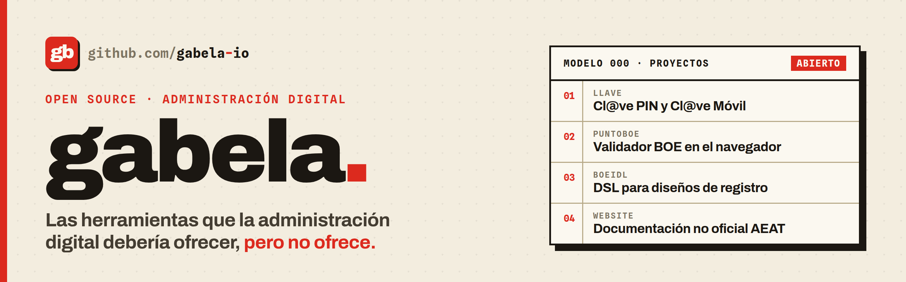

<picture>
  <source media="(prefers-color-scheme: dark)" srcset="assets/banner-dark.png">
  
</picture>

  <a href="#gabela"><b>Español</b></a> · <a href="#gabela-1"><b>English</b></a>

## gabela.

Las herramientas que la administración digital debería ofrecer, pero no ofrece.

> *Gabela*: palabra antigua para un impuesto o tributo. Sabemos exactamente contra qué estamos peleando.

### Proyectos

| Proyecto | Qué hace | Estado |
|----------|----------|--------|
| [**llave**](https://github.com/gabela-io/llave) | Implementación open-source de Cl@ve PIN / Cl@ve Móvil. Núcleo en Rust, clientes CLI y Flutter (Windows, Linux, macOS, Android, iOS) | `En desarrollo` |
| [**puntoBOE**](https://github.com/gabela-io/puntoBOE) | Validador de ficheros BOE que funciona 100% en el navegador. Tus datos no salen de tu equipo (Modelo 720 por ahora) | `En desarrollo` |
| [**boeidl**](https://github.com/gabela-io/boeidl) | Compilador DSL en Rust para los diseños de registro de la AEAT: serializa, deserializa y valida (Modelo 130 por ahora) | `Alpha` |
| [**website**](https://github.com/gabela-io/website) | Documentación no oficial sobre la AEAT y la administración tributaria española | `En desarrollo` |

### Por qué

Firmar con certificado digital, autenticarse con Cl@ve, validar ficheros tributarios: todo esto debería ser sencillo. En la práctica, la documentación es ininteligible y obsoleta, y las herramientas son deliberadamente opacas. El resultado es frustración para quien solo intenta cumplir con sus obligaciones. gabela construye alternativas abiertas para que no tengas que descifrarlo tú solo.

La administración digital es un servicio público. Sus herramientas, formatos y protocolos deberían ser abiertos, documentados y auditables. Cuando no lo son, es responsabilidad de los ciudadanos exigirlo, y de proyectos como este demostrar que es posible.

### Contribuir

Las contribuciones son bienvenidas. Abre un issue para reportar errores o proponer mejoras, o envía un PR directamente.

### Apóyanos

Dale una estrella al proyecto que te sea útil, compártelo con quien esté peleándose con Hacienda y cuéntanos qué trámite te gustaría ver resuelto.

---

## gabela.

The tools digital government should offer, but doesn't.

> *Gabela*: an old Spanish word for a tax or levy. We know exactly what we're up against.

### Projects

| Project | What it does | Status |
|---------|--------------|--------|
| [**llave**](https://github.com/gabela-io/llave) | Open-source implementation of Spain's Cl@ve PIN / Cl@ve Móvil. Rust core, CLI and Flutter clients (Windows, Linux, macOS, Android, iOS) | `In development` |
| [**puntoBOE**](https://github.com/gabela-io/puntoBOE) | BOE tax filing validator that runs entirely in the browser via WebAssembly. Your data never leaves your machine (Modelo 720 for now) | `In development` |
| [**boeidl**](https://github.com/gabela-io/boeidl) | Rust DSL compiler for the AEAT's record layouts: serialize, deserialize and validate (Modelo 130 for now) | `Alpha` |
| [**website**](https://github.com/gabela-io/website) | Unofficial documentation on the AEAT and Spanish tax administration | `In development` |

### Why

Signing with digital certificates, authenticating with Cl@ve, validating tax filings: all of this should be straightforward. In practice, documentation is unintelligible and outdated, and tools are deliberately opaque. The result is frustration for citizens just trying to meet their obligations. gabela builds open alternatives so you don't have to figure it out alone.

Digital administration is a public service. Its tools, formats, and protocols should be open, documented, and auditable. When they're not, it's on citizens to demand it, and on projects like this to prove it's possible.

### Contributing

Contributions are welcome. Open an issue to report bugs or suggest improvements, or send a PR directly.

### Support

Star the projects you find useful, share them with anyone fighting the tax office, and tell us which procedure you'd like to see solved next.

Banners are generated from the gabela design system with <a href="https://github.com/gabela-io/.github/tree/main/banners"><code>banners/</code></a>.
